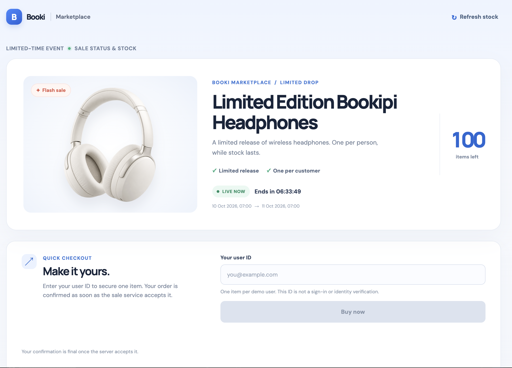
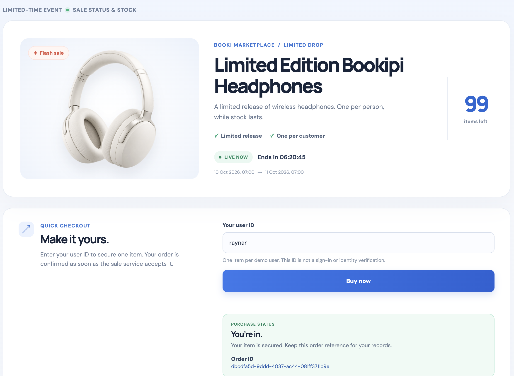
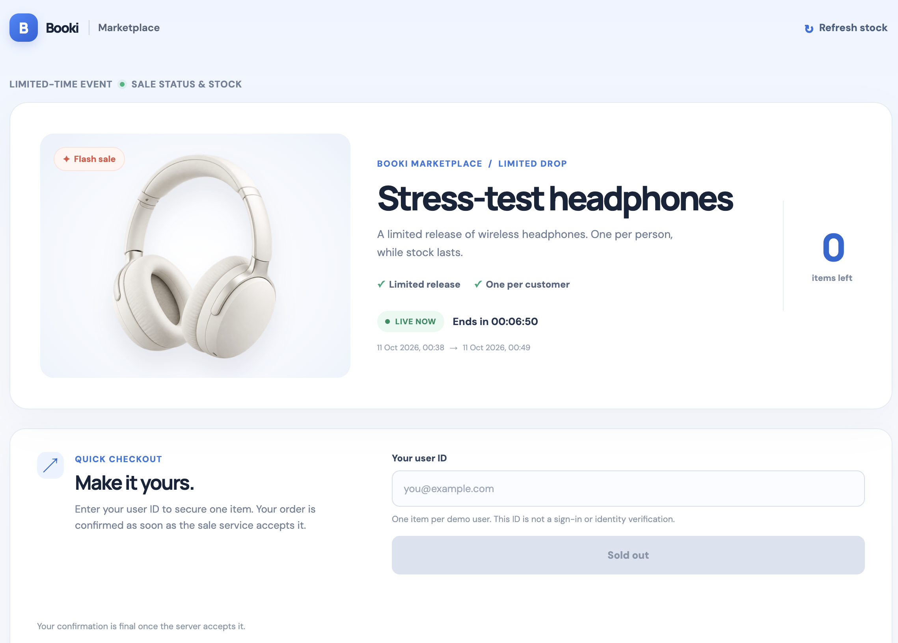
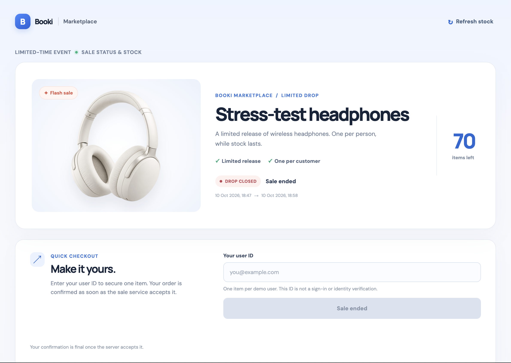

# Bookipi Flash Sale

A small flash-sale assessment focused on correctness: one active product, limited stock, one confirmed item per user, and retry-safe purchase requests.

## Stack

- React + Vite + TypeScript demo client
- Fastify + TypeScript API
- PostgreSQL 16 for transactional inventory correctness
- Redis 7 for purchase-route rate limiting
- Docker Compose for local PostgreSQL and Redis

## Architecture

```mermaid
flowchart LR
  C[React demo client] --> E[Local rate protection]
  E --> A[Fastify API]
  A --> R[(Redis)]
  A --> D[(PostgreSQL)]
  D --> I[Sale row lock and constraints]

  subgraph Production-scale evolution — not implemented locally
    PA[Stateless API replicas] --> Q[FIFO queue partitioned by product]
    Q --> W[Reservation worker]
    W --> PD[(Orders and inventory database)]
  end
```

The local service locks the active sale row with `SELECT ... FOR UPDATE`, checks eligibility, inserts the order, decrements stock, and commits in one PostgreSQL transaction. This is correct and intentionally simple locally, but serializes attempts for a hot product. Production evolves to a durable FIFO queue partitioned by product; PostgreSQL constraints remain the final safeguard.

## Local setup

Prerequisites: Node.js 20+, pnpm 9+, and Docker Compose (or Colima on macOS).

```sh
pnpm install
cp .env.example .env
docker compose up -d
docker compose exec postgres createdb -U flash_sale flash_sale_test
pnpm -C backend migrate
pnpm -C backend dev
```

The backend automatically loads root `.env`, so Fish, Zsh, and Bash need no shell-specific export commands. PostgreSQL is published at host port `5433`; Redis uses `6379`.

In another terminal:

```sh
pnpm -C frontend dev
```

Open Vite's URL (normally `http://localhost:5173`). Its `/api` proxy targets Fastify on port `3000`.

## Frontend walkthrough

The screenshots below show the main browser states: an active sale, a confirmed
purchase, sold-out inventory, and an ended sale.

After a page refresh, enter the same demo user ID and choose **Already purchased?
Check order** to restore the existing order reference through
`GET /api/purchases/me`. The demo ID is entered again rather than persisted in
browser storage; it is not an authenticated identity.

### Happy path — sale open and checkout ready



### Successful purchase — order confirmed



### Unhappy path — sold out



### Unhappy path — sale ended



## Start a demo sale

No active sale exists after migration by design. Open `http://localhost:3000/docs`, authorize `InternalApiKey` with the raw `INTERNAL_API_KEY` value from `.env`, then run `POST /api/internal/sales/reset` with an active window.

```json
{
  "initialStock": 100,
  "startsAt": "2026-10-10T00:00:00.000Z",
  "endsAt": "2026-10-11T00:00:00.000Z",
  "productName": "Limited Edition Bookipi Headphones"
}
```

Internal endpoints are absent in production and intentionally return `404` when their key is missing or incorrect in development.

## API

| Method | Endpoint | Purpose |
| --- | --- | --- |
| `GET` | `/api/sale` | Public sale state, window, and remaining stock. |
| `POST` | `/api/purchases` | Attempts one purchase; requires `Idempotency-Key: <uuid>`. |
| `GET` | `/api/purchases/me?userId=...` | Looks up the active-sale purchase for a user. |
| `POST` | `/api/internal/sales/reset` | Development/test-only repeatable reset. |
| `GET` | `/api/internal/metrics` | Development/test-only inventory invariants. |

```http
POST /api/purchases
Idempotency-Key: f47ac10b-58cc-4372-a567-0e02b2c3d479
Content-Type: application/json

{ "userId": "yoga@example.com" }
```

Valid purchase outcomes are `confirmed`, `already_purchased`, `upcoming`, `ended`, and `sold_out`. The same key and user returns the original confirmed order without another decrement. Reusing a key for a different user returns `409 IDEMPOTENCY_KEY_REUSED`.

## Tests

```sh
# Unit tests; no database required
pnpm -C backend test

# Integration and concurrency tests; requires flash_sale_test
pnpm -C backend test:integration

pnpm build
pnpm typecheck
```

Integration tests only run with `TEST_DATABASE_URL` and refuse URLs that do not include `flash_sale_test`. Coverage includes sale-window boundaries, validation, public outcomes, idempotency retries, one-user enforcement, internal-route protection, and concurrent reservations.

## Stress test

The stress runner resets the active sale and deletes its existing orders through
the internal reset endpoint. Use a dedicated test/demo database and a dedicated
backend process. Raise the backend's rate limit temporarily so this scenario
measures inventory contention instead of intentional `429` load shedding; keep
the normal development default for manual testing:

```sh
RATE_LIMIT_MAX=120000 RATE_LIMIT_WINDOW_MS=60000 pnpm -C backend dev
```

Then, in another terminal, run the recorded 100,000-request scenario:

```sh
STRESS_REQUESTS=100000 STRESS_CONCURRENCY=50 STRESS_STOCK=100 pnpm -C backend stress
```

The script resets an active sale through the protected internal endpoint, then reports outcome counts, elapsed time, request rate, p50/p95/p99 latency, and invariant metrics. It passes only with no unexpected transport/non-2xx errors, no oversell, unique confirmed users, non-negative stock, and conserved inventory. This is local correctness/load verification, not a production capacity claim.

### Recorded local run

| Requests | Concurrency | Initial stock | Confirmed | Sold out | Other errors | Elapsed | Throughput | Latency p50 / p95 / p99 | Invariants | Result |
| ---: | ---: | ---: | ---: | ---: | ---: | ---: | ---: | --- | --- | --- |
| 100,000 | 50 | 100 | 100 | 99,900 | 0 | 257.4 s | 388.5 req/s | 113.6 / 210.6 / 300.9 ms | All true | PASS |

The backend admitted the full workload without `429` responses. The database
confirmed exactly the 100 available items; all other admitted attempts returned
`sold_out`. Metrics reported `stockRemaining: 0`, `confirmedOrderCount: 100`,
`duplicateUserCount: 0`, and `stockNonNegative`, `noOversell`,
`uniqueConfirmedUsers`, and `stockConserved` all true. These measurements apply
to this local environment and configuration only; they are not a production
capacity claim. A separate run with a lower rate limit may return expected
`429` responses and should be reported as load-shedding behavior, not as this
inventory stress scenario's passing result.

## Scope boundaries

- `userId` stands in for authenticated identity; production derives it from a verified session/JWT.
- Payment, cancellation, reservation expiry, and inventory release are out of scope.
- Local implementation has one active sale and one product.
- Server/database time is authoritative; client time cannot decide eligibility.
- Redis failure can affect configured rate-limit behavior, never database correctness.
