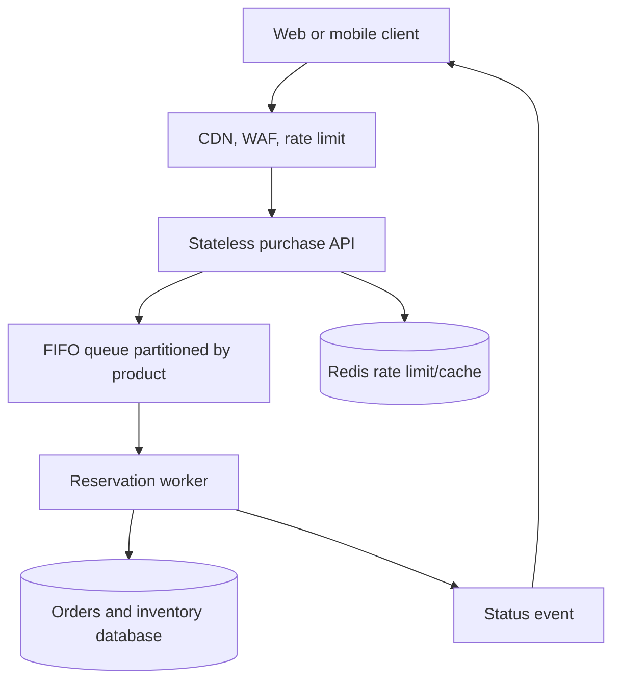

# Architecture Plan

## Chosen stack

- **Frontend:** React + Vite + TypeScript
- **API:** Node.js + Fastify + TypeScript
- **Database:** PostgreSQL 16
- **Rate-limit/cache layer:** Redis 7
- **Local environment:** Docker Compose
- **Tests:** Vitest + Fastify `inject` integration tests + Node stress script

Fastify is selected because the assessment centres on a high-throughput API. It is lightweight, has schema validation and rate-limit plugins, and keeps the API independently scalable from the React client. Next.js would also be valid, but would blur the frontend/API boundary that this exercise is explicitly evaluating.

## Public API contract

### `GET /api/sale`

Returns the current sale state.

```json
{
  "id": "uuid",
  "name": "Limited Edition Bookipi Headphones",
  "status": "active",
  "stockRemaining": 99,
  "startsAt": "2026-10-10T02:00:00.000Z",
  "endsAt": "2026-10-10T03:00:00.000Z"
}
```

### `POST /api/purchases`

Request headers: `Idempotency-Key: <uuid>`.

```json
{ "userId": "yoga@example.com" }
```

Terminal outcomes are `confirmed`, `already_purchased`, `upcoming`, `ended`, and `sold_out`.

### `GET /api/purchases/me?userId=<id>`

Returns `{ "purchased": true, "orderId": "uuid" }` or `{ "purchased": false }`.

## Local transaction flow

1. API validates input, rate limit, and idempotency key.
2. A database transaction acquires `SELECT ... FOR UPDATE` on the active sale row.
3. It checks sale time, existing user order, then remaining stock.
4. It inserts the confirmed order and decrements stock before committing.
5. A rollback leaves both the order and stock unchanged.

This deliberately keeps the local system simple and provably correct. The row lock is a bottleneck for a single ultra-hot product, which is why the production architecture below serializes each product through a durable FIFO queue.

## Production-scale architecture



The queue assigns the accepted server-side order. A worker processes a product partition sequentially, while database constraints remain the final protection against duplicate users and overselling. The client receives `processing` first in this architecture, then checks status or receives an event.

## Data model

```text
flash_sales
- id (uuid, PK)
- product_name
- starts_at / ends_at
- stock_remaining (check >= 0)
- active

orders
- id (uuid, PK)
- sale_id (FK)
- user_id
- idempotency_key
- status = confirmed
- created_at
- UNIQUE(sale_id, user_id)
- UNIQUE(sale_id, idempotency_key)
```

## Verification strategy

1. Unit tests for sale-state calculations.
2. API integration tests for the five outcomes and validation failures.
3. Concurrent integration test: many requests, limited stock, no duplicates, no negative stock.
4. Stress script with configurable request count and concurrency.
5. Internal metrics verifies: `confirmedOrders + stockRemaining = initialStock`, confirmed users are unique, and stock is non-negative.

## Delivery checkpoints

1. Requirements and architecture plan — complete.
2. Dependency-ordered task breakdown.
3. Backend/database implementation.
4. React client.
5. Tests, stress test, and documentation verification.
